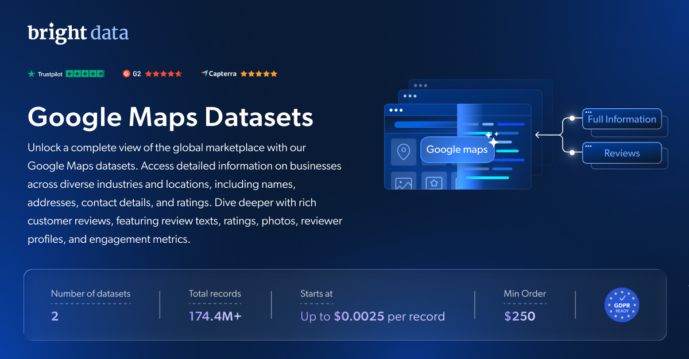

# Google Maps 数据集样本

<h2>包含 1001 家 Google Maps 商家的示例数据集</h2>

<a href="https://www.bright.cn/products/datasets/google-maps">
   
</a>

包含超过 1000 家商家的 Google Maps 数据集样本。该数据集使用 <b>Bright Data API</b> 提取。

<h2>此免费数据集包含的数据点：</h2>

* ```place_id```：Google Maps 上地点的唯一标识符
* ```name```：商家名称
* ```category```：商家的类别或类型
* ```address```：商家的实际地址
* ```lat```：商家所在地的纬度坐标
* ```lon```：商家所在地的经度坐标
* ```url```：指向 Google Maps 上该商家的 URL
* ```country```：商家所在的国家/地区
* ```phone_number```：商家的联系电话
* ```main_image```：与商家相关的主图片 URL 或标识符
* ```reviews_count```：商家的评论总数
* ```rating```：客户给出的平均评分
* ```reviews```：客户留下的评论或反馈
* ```open_hours```：商家的营业时间
* ```open_hours_updated```：最近更新的营业时间
* ```price_range```：商家的价格范围
* ```services_provided```：商家提供的服务列表
* ```open_website```：指向商家网站的链接，或表明商家是否有可访问网站的信息
* ```category_search_input```：用于获取此结果的类别搜索输入

以及更多内容。

这是“Google Maps 商家（公开数据）”数据集的示例子集，该完整数据集包含超过 <b>46,000,000 家商家</b>。

可用的数据集文件格式：<b>JSON、NDJSON、JSON Lines、CSV 或 Parquet。还可选择将文件压缩为 .gz 格式</b>。

数据集交付方式选项：<b>电子邮件、API 下载、Webhook、Google Maps S3、Google Cloud Storage、Google Cloud Pub/Sub、Microsoft Azure、Snowflake、SFTP</b>。

更新频率：<b>单次、每日、每周、每月、每季度或自定义</b>。

可在提取的数据点基础上添加数据扩充服务：<b>根据请求提供。</b>

<b>[获取完整的 Google Maps 数据集](https://www.bright.cn/products/datasets/google-maps)</b>。

<a href="https://www.bright.cn/products/datasets/google-maps">
   
</a>

<h2>Google Maps 数据集有哪些使用场景？</h2>

<h3>1. 竞品分析</h3>
利用 Google Maps 数据集定位并分析特定地区的竞争对手。通过评论和评分数据，企业可以深入了解竞争对手的优势与劣势，而人员与职位数据集则可进一步优化 CRM 策略。

<h3>2. 基于位置的营销</h3>
Google Maps 数据集提供广泛的位置数据，帮助企业精细调整营销策略。通过分析用户行为并识别热门目的地，企业可以优化地理位置定向营销活动。

<h3>3. 市场策略</h3>
利用 Google Maps 数据集制定高度精准的营销策略和销售拓展计划。这些数据包含全面的商家详情、评分和评论，可帮助企业识别全球范围内的关键潜在客户和竞争对手。

<h2>面向学术研究人员和 NGO 免费提供网页爬虫工具及数据集</h2>

Bright Initiative 为顶尖学术院系和研究人员，以及致力于推动各类环境与社会事业的 NGO 和 NPO，提供 Bright Data 的 <b>[网页爬虫工具 API](https://www.bright.cn/products/web-scraper)</b> 和 <b>[即用型数据集](https://www.bright.cn/products/datasets)</b>。你可以在<b>[此处](https://brightinitiative.com)</b>提交申请。
